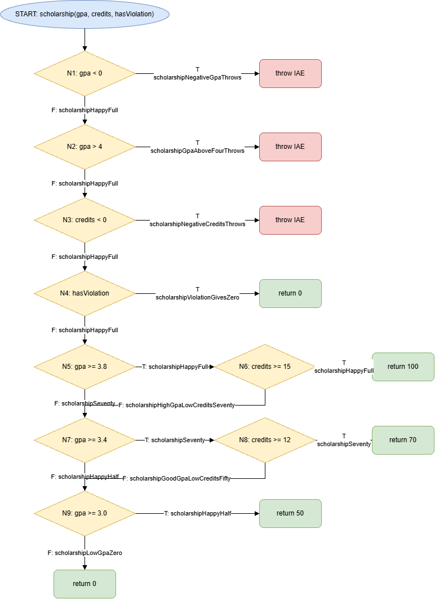

# Лаб 9: JaCoCo хамралт ба бүтцийн тест

- Нэр: А.Адъяахүү
- Оюутны код: B232270125

## Орчин (`java -version` ба `mvn -version`-ийн бүтэн гаралт)

```text
openjdk version "17.0.21.0.3" 2026-10-24
OpenJDK Runtime Environment (build 17.0.21.0.3+1-1-26.04.1-Ubuntu)
OpenJDK 64-Bit Server VM (build 17.0.21.0.3+1-1-26.04.1-Ubuntu, mixed mode, sharing)
Apache Maven 3.9.12
Maven home: /usr/share/maven
Java version: 17.0.21.0.3, vendor: Ubuntu, runtime: /usr/lib/jvm/java-17-openjdk-amd64
Default locale: en, platform encoding: UTF-8
OS name: "linux", version: "6.18.54.1-microsoft-standard-wsl2", arch: "amd64", family: "unix"
```

## Хэсэг A: Happy path тестүүд ба эхний хэмжилт

Хэвийн урсгалын 5 тест бичсэний дараа Branch хамралт 53.7% (22/41), Line хамралт 68.0% (17/25) гарсан (`results/jacoco-A.csv`).

Шар ромбо бүхий мөрүүд нь `if`, `||`, `&&` нөхцөлийн зөвхөн нэг салаа хамрагдсаныг заана. Жишээ нь `letterGrade`-ийн `score >= 70`, `scholarship`-ийн `hasViolation`, `gpa >= 3.0` нөхцөлүүд зөвхөн үнэн эсвэл зөвхөн худал чиглэлд ажилласан.

Улаан (огт хүрээгүй) 8 мөр нь гурван `throw` бүхий алдааны зам, `letterGrade`-ийн D/F салаа, `gpa`-ийн `switch` доторх C/D тохиолдол, `scholarship`-ийн `return 0` юм. Happy-path тестүүд эдгээрийг дайрдаггүй.

## Хэсэг B: CFG ба Branch/Line 100%



`scholarship()` функцийн CFG-г draw.io дээр зурж, ирмэг бүрийг тест рүү буулгасан. Branch ба Line хамралтыг 100% болгохын тулд нийт 21 тест шаардагдсан (`results/mvn-verify-B.txt` дахь `Tests run: 21`). `results/jacoco-B.csv`-д BRANCH_MISSED = 0, LINE_MISSED = 0.

AI ашигласан хэсэг: CFG-ийн эхний загвар болон ирмэг-тестийн буулгалтыг Claude-ийн тусламжтайгаар бэлтгэсэн бөгөөд ирмэг бүрийг тесттэй өөрөө тулгаж шалгасан.

## Хэсэг C: Давталтын заагийн тестүүд

`gpa()` функцийн давталтыг 0, 1, 2+ удаа ажиллуулдаг 3 тест нэмсэн: `gpaLoopZeroIterationsThrows` (хоосон массив), `gpaLoopOneIteration` (нэг оноо), `gpaLoopManyIterations` (гурван оноо). Мөн null оролтыг `gpaNullThrows` тест `assertThrows(IllegalArgumentException.class, ...)`-оор шалгана.

Эдгээр тест нь хамралтын тоог өсгөөгүй (Branch/Line аль хэдийн 100%). Гэхдээ хамралт нь мөр, салаа дайрсныг л хэмждэг болохоор давталт 0, 1, олон удаа ажиллахад дундаж зөв бодогдож, хоосон оролтыг зөв боловсруулж байгааг зөвхөн ийм заагийн тестүүд л баталгаажуулдаг.

## Хэсэг D: Хамралт 100% боловч алдаа амьд байсан

Зааг утгын 7 тест нэмж `mvn test` ажиллуулахад 31 тестийн 1 нь унасан: `letterGradeBoundary60IsD` — `expected: <D> but was: <F>` (`results/mvn-test-D-fail.txt`). Алдаа нь `letterGrade` дотор `score > 60` гэж бичигдсэн байсан бөгөөд спецификаци 60 оноог "D" гэж заасан тул `score >= 60` болгож засав (засварын commit `33473b7`). Засварын дараа `mvn verify` дээр 31 тест бүгд ногоон, `BRANCH_MISSED = 0`, `LINE_MISSED = 0` (`results/mvn-verify-final.txt`, `results/jacoco-final.csv`).

**Гол дүгнэлт.** Branch хамралт 100% байхад энэ алдаа "үл үзэгдэгч" байсан, учир нь `score > 60` ба `score >= 60` хоёул адилхан үнэн/худал хоёр салаа үүсгэдэг. Өмнөх 65 оноотой тест үнэн салааг, 30 оноотой тест худал салааг дайрсан тул хоёр хувилбар хамралтын хувьд ялгагдахгүй байв. Зөвхөн яг 60 оноотой тест л хоёр операторын ялгааг илрүүлнэ. Хамралт нь тест аль мөр, салааг дайрсныг хэмждэг боловч тестийн хүлээгдэж буй утга спецификацитай таарч байгааг, зааг утгыг зөв шалгасныг хэмждэггүй. Иймээс 100% хамралт нь код зөв гэсэн баталгаа биш, зөвхөн тест хэсэг хүрээгүй хэвээр үлдээгээгүйг л харуулна.
